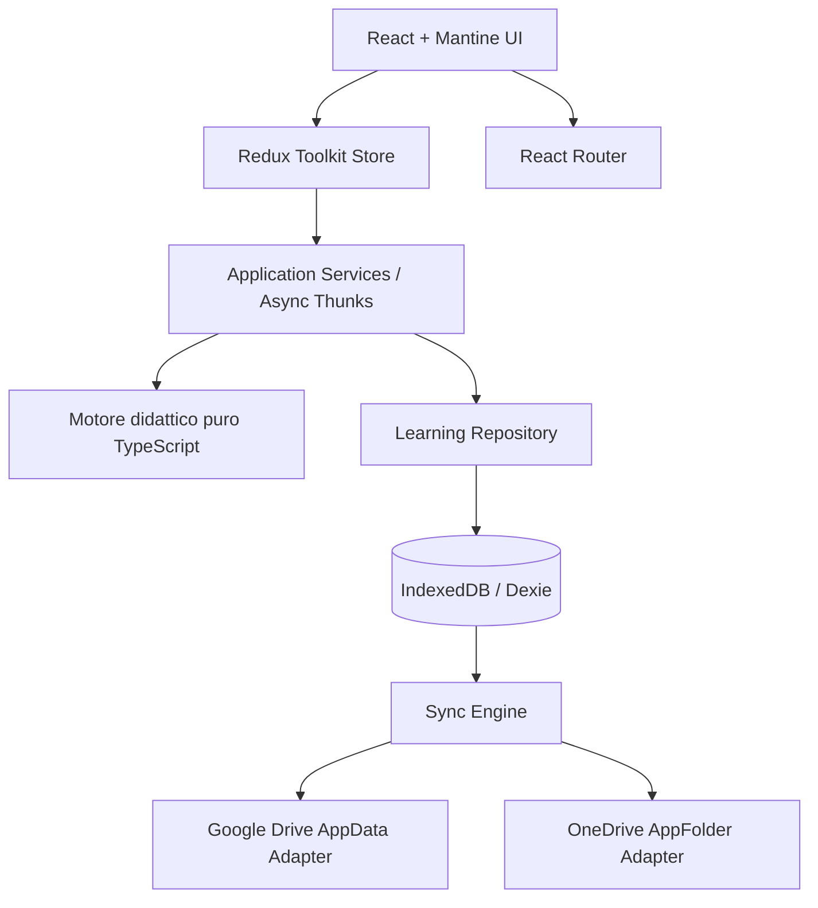
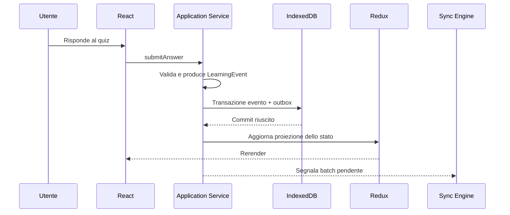

# Guidami — Specifica tecnica dell'applicazione frontend

**Versione:** 1.0  
**Stato:** Proposta architetturale da approvare  
**Ambito:** stack, struttura frontend, state management, UI, styling, build e qualità  
**Documento correlato:** [Persistenza e sincronizzazione](./patente-tutor-storage-sync-spec.md)

## 1. Obiettivo

Realizzare Guidami come **Single Page Application (SPA)** responsive, installabile come Progressive Web App (PWA), completamente client-side, destinata alla preparazione dei quiz della patente italiana. Nessun backend applicativo, database centralizzato o servizio AI runtime è richiesto. Le domande, i percorsi e le regole adattive sono progettati e versionati a priori; il motore applicativo seleziona i percorsi in base alla valutazione iniziale e ai progressi misurati.

Questa specifica definisce lo **scheletro tecnico**, non ancora la composizione definitiva delle schermate o il design visivo.

## 2. Stack proposto

| Area | Scelta | Motivazione |
|---|---|---|
| Build e dev server | **Vite** | Build veloce, TypeScript e Sass supportati |
| Linguaggio | **TypeScript** in modalità strict | Contratti espliciti e manutenzione |
| UI runtime | **React** | Ecosistema maturo, composizione componenti |
| Routing | **React Router** | Navigazione SPA e deep link |
| Stato applicativo | **Redux Toolkit + React Redux** | Slice, selectors, middleware, DevTools |
| Persistenza locale | **IndexedDB** con **Dexie** | Query, transazioni, migrazioni e offline |
| Cloud sync | Adapter Google Drive e Microsoft OneDrive | Implementati secondo la specifica dedicata |
| Componenti UI | **Mantine** | Accessibilità, form, overlay, layout responsive, theming |
| Styling | **SCSS (Dart Sass) + CSS Modules** | CSS compilato, modularità e personalizzazione |
| Design tokens | CSS custom properties + SCSS maps/mixins | Cambi tema senza riscrivere componenti |
| Icone | **Lucide React** | Iconografia coerente e leggera |
| PWA | **vite-plugin-pwa** | Manifest, precache e supporto offline |
| Test unitari | **Vitest + Testing Library** | Test del dominio e dei componenti |
| Test end-to-end | **Playwright** | Flussi reali su browser e dispositivi |
| Lint e formattazione | **ESLint + Prettier** | Qualità consistente |
| Deployment | **Vercel** | Hosting statico e fallback SPA |

Le librerie sono scelte progettuali proposte: **Mantine e l'impostazione SCSS sono da validare prima della realizzazione della UI finale**. Evitare dipendenze aggiuntive finché non giustificate da requisiti concreti.

## 3. Principi architetturali

1. **Local-first**: ogni risposta e avanzamento viene salvato localmente senza attendere la rete.
2. **Separazione dei livelli**: UI, stato, logica didattica, persistenza e sincronizzazione non devono dipendere l'uno dall'altro in modo circolare.
3. **Dominio puro**: calcolo score, selezione quiz e instradamento dei percorsi sono funzioni TypeScript deterministiche, testabili senza React.
4. **Redux non è il database**: IndexedDB è la persistenza durevole; Redux rappresenta lo stato operativo e la vista corrente.
5. **Provider-agnostic**: Google e Microsoft non influenzano componenti UI o algoritmi didattici.
6. **Accessibilità**: navigazione da tastiera, focus visibile, semantica corretta, testi comprensibili e supporto mobile.
7. **Configurabilità visiva**: palette, spaziature, tipografia e breakpoint centralizzati.
8. **Privacy**: nessuna telemetria dei progressi o identificazione applicativa centralizzata.

## 4. Architettura dei livelli



La freccia IndexedDB → Sync Engine è concettuale: il Sync Engine legge dal repository locale, non da Redux. L'interazione può essere orchestrata da servizi applicativi e da un event/outbox dispatcher.

## 5. State management con Redux Toolkit

### Slice proposte

| Slice | Contenuto | Persistenza |
|---|---|---|
| `app` | Stato inizializzazione, errori generali | No |
| `navigation` | Navigazione e flussi UI | No |
| `quizSession` | Domanda corrente, risposte in corso, timer | Checkpoint selettivo |
| `learning` | Progressi aggregati e percorso corrente | Derivato da repository |
| `settings` | Preferenze UI e accessibilità | Sì, tramite repository |
| `sync` | Provider, stato connessione, pending, ultimo sync | Metadati selettivi |
| `content` | Stato caricamento del catalogo versionato | No, asset statici |

Usare **Redux Toolkit** con `configureStore`, `createSlice`, selectors tipizzati e `createAsyncThunk` o listener middleware quando necessario. Preferire stato locale React per interazioni effimere di singoli componenti; non mettere tutto indiscriminatamente nello store.

### Flusso di scrittura



**Regola vincolante:** non confermare come persistita una risposta prima del commit IndexedDB. In caso di errore locale mostrare un messaggio e consentire il retry; non perdere silenziosamente la risposta.

### Reidratazione

All'avvio, inizializzare Dexie, eseguire eventuali migrazioni, leggere le proiezioni o ricostruirle dagli eventi, quindi popolare Redux. Non serializzare automaticamente l'intero Redux store in `localStorage` e non utilizzare Redux Persist come fonte autorevole dei progressi.

Esempio di configurazione:

```typescript
import { configureStore } from "@reduxjs/toolkit";
import { appReducer } from "./slices/appSlice";
import { quizSessionReducer } from "./slices/quizSessionSlice";
import { learningReducer } from "./slices/learningSlice";
import { settingsReducer } from "./slices/settingsSlice";
import { syncReducer } from "./slices/syncSlice";

export const store = configureStore({
  reducer: {
    app: appReducer,
    quizSession: quizSessionReducer,
    learning: learningReducer,
    settings: settingsReducer,
    sync: syncReducer,
  },
});

export type RootState = ReturnType<typeof store.getState>;
export type AppDispatch = typeof store.dispatch;
```

Il codice è illustrativo; i moduli indicati devono essere creati.

## 6. Motore didattico

Il motore didattico non utilizza LLM o servizi AI. Le regole sono definite in configurazioni versionate e testabili.

Responsabilità:

- Valutazione iniziale dello studente e calcolo del profilo di partenza.
- Selezione dei quiz da un catalogo predefinito.
- Progressione della difficoltà in base a criteri misurabili.
- Identificazione di argomenti da ripassare e pianificazione delle ripetizioni.
- Ricostruzione dei progressi dagli eventi persistiti.
- Versionamento delle regole per evitare reinterpretazioni impreviste dei dati storici.

I dati di contenuto statico devono avere ID stabili e versioni esplicite. Evitare di inserire l'intero catalogo domande nello store Redux se può essere letto da asset statici o repository di contenuti.

## 7. UI framework e componenti

### Scelta proposta: Mantine

Mantine è il layer di componenti React; non deve diventare il proprietario della logica applicativa. Utilizzare un **design system interno** con componenti wrapper (`AppButton`, `AppCard`, `QuestionCard`, `ProgressIndicator`, `AppDialog`) per isolare l'app dalla libreria UI e consentire eventuali sostituzioni.

Usare i componenti Mantine dove utili per accessibilità, responsive, form, modali e feedback. Per i componenti specifici dei quiz costruire componenti dedicati.

Non definire in questa fase layout finale, colori definitivi, illustrazioni o navigazione di dettaglio: saranno oggetto di una successiva specifica UX/UI.

### Requisiti UX tecnici

- Mobile-first e layout adattivo desktop/tablet/mobile.
- Touch target sufficientemente ampi e navigazione da tastiera.
- Focus management nei dialog e dopo i cambi domanda.
- Stati loading, empty, error, offline e syncing espliciti.
- Contrasto e zoom adeguati; preferenza reduced-motion rispettata.
- Testi e interazioni progettati per semplicità di lettura e comprensione.
- Localizzazione predisposta per estensione, con italiano come lingua iniziale.

## 8. CSS compilato e theming

### Decisione: Sass + CSS Modules

Vite compila **SCSS** durante build e sviluppo. Usare **Dart Sass** come dipendenza di sviluppo; non servono script di compilazione CSS separati. I CSS Modules isolano gli stili dei componenti; i file globali sono limitati a reset, font, tokens e utility condivise.

Struttura proposta:

```text
src/styles/
  _tokens.scss
  _mixins.scss
  _breakpoints.scss
  _typography.scss
  themes/
    _light.scss
    _dark.scss
  global.scss
src/components/QuestionCard/
  QuestionCard.tsx
  QuestionCard.module.scss
```

Definire **CSS custom properties** per i token modificabili a runtime (es. tema chiaro/scuro, contrasto, dimensione testo), e SCSS per mixin, organizzazione e trasformazioni a build time. Evitare di affidare i colori principali solo a variabili Sass, che non sono modificabili a runtime.

Esempio:

```scss
:root {
  --app-color-primary: #275dad;
  --app-color-surface: #ffffff;
  --app-color-text: #17202a;
  --app-space-md: 1rem;
  --app-radius-md: 0.75rem;
}

[data-theme="dark"] {
  --app-color-surface: #151b24;
  --app-color-text: #f2f4f7;
}
```

```scss
/* QuestionCard.module.scss */
.card {
  padding: var(--app-space-md);
  border-radius: var(--app-radius-md);
  background: var(--app-color-surface);
  color: var(--app-color-text);
}
```

I valori sono dimostrativi e non rappresentano la palette finale. Integrare i token Mantine con quelli applicativi per evitare due fonti di verità; definire mapping e override nel tema centrale.

### Vincoli

- Niente CSS inline per stili strutturali.
- Niente override sparsi delle classi interne di Mantine.
- Niente CSS-in-JS obbligatorio per lo styling applicativo.
- Preferire SCSS Modules; globali solo per tokens, reset e stili davvero condivisi.
- Consentire sostituzione del tema senza modificare la logica React.

## 9. Organizzazione del progetto

```text
/
  public/
    icons/
  src/
    app/
      App.tsx
      router.tsx
      store.ts
      providers/
    domain/
      assessment/
      learning-path/
      quiz/
      scoring/
    features/
      onboarding/
      assessment/
      quiz/
      progress/
      review/
      settings/
    components/
      ui/
      layout/
      feedback/
    state/
      slices/
      selectors/
      middleware/
    storage/
      local/
      cloud/
      auth/
      sync/
      migration/
      models/
    content/
      schemas/
      repositories/
    styles/
      themes/
      global.scss
      _tokens.scss
      _mixins.scss
    test/
      fixtures/
      helpers/
    main.tsx
  e2e/
  specs/
  index.html
  vite.config.ts
  tsconfig.json
  package.json
```

La cartella `storage` deve mantenere i contratti previsti dalla specifica di persistenza e sincronizzazione già presente nel repository.

## 10. PWA, offline e deployment

- Registrare service worker tramite `vite-plugin-pwa`.
- Precache dell'app shell e degli asset statici necessari al funzionamento offline.
- Versionare il catalogo quiz e definire una strategia di aggiornamento controllata.
- Evitare caching indiscriminato delle chiamate OAuth e delle API Google/Microsoft.
- Pubblicare su Vercel come build statica (`dist/`).
- Configurare fallback SPA per le route applicative.
- Mantenere i client ID OAuth in variabili `VITE_*` (pubbliche), **mai** client secret.
- Non includere token o dati utente in log e analytics.
- Gestire esplicitamente update PWA e migrazioni IndexedDB.

## 11. Qualità e test

| Livello | Test minimi |
|---|---|
| TypeScript | `strict`, assenza di `any` non giustificati |
| Unit | Regole di scoring, progressione e selezione percorsi |
| Redux | Reducer, selectors, orchestrazione e reidratazione |
| IndexedDB | Transazioni, migrazioni e failure recovery |
| Sync | Deduplica, concorrenza, offline, retry e cambio account |
| Component | Rendering, accessibilità e interazioni principali |
| E2E | Percorso anonimo, quiz, riapertura, recupero progressi |
| Build | Typecheck, lint, test e `vite build` |
| PWA | Installabilità, caching offline e aggiornamenti |

I test OAuth reali devono essere separati dai test CI ordinari e non devono richiedere credenziali personali nel repository. Usare mock degli adapter nei test unitari/integration.

## 12. Criteri di accettazione

1. `npm run dev` avvia l'app Vite in locale.
2. `npm run build` produce una SPA statica deployabile su Vercel.
3. TypeScript strict, lint e test sono eseguibili in CI.
4. Redux Toolkit governa lo stato applicativo senza diventare archivio persistente.
5. IndexedDB mantiene i progressi dopo refresh e riapertura.
6. Il motore didattico è utilizzabile senza rete o provider OAuth.
7. Gli adapter Google e Microsoft sono sostituibili tramite contratto comune.
8. La UI utilizza componenti Mantine incapsulati dove opportuno.
9. Gli stili SCSS sono compilati da Vite e i CSS Modules evitano collisioni.
10. Temi e token possono essere modificati centralmente senza intervenire sulla logica applicativa.
11. Il frontend è responsive, accessibile e predisposto per PWA.
12. Il repository non contiene client secret o credenziali private.

## 13. Decisioni da confermare

- **Mantine** come framework di componenti UI, rispetto ad alternative quali MUI o shadcn/ui.
- **Redux Toolkit** rispetto a Zustand; Redux è la scelta proposta per orchestrazione e osservabilità.
- **SCSS Modules + CSS custom properties** come approccio CSS, senza introdurre Tailwind salvo nuova decisione.
- Definizione successiva di schermate, navigazione, branding e componenti didattici.
