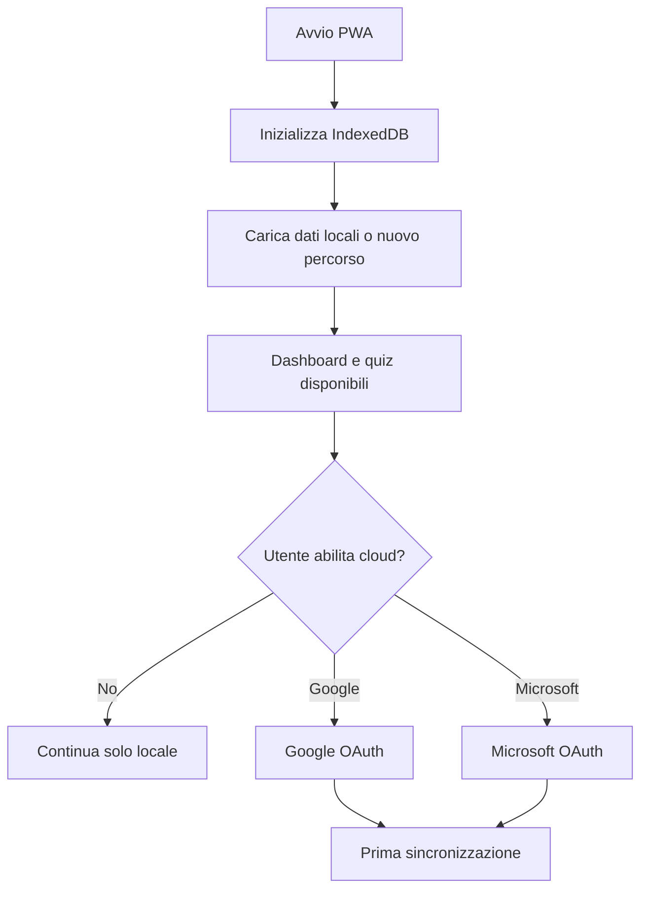
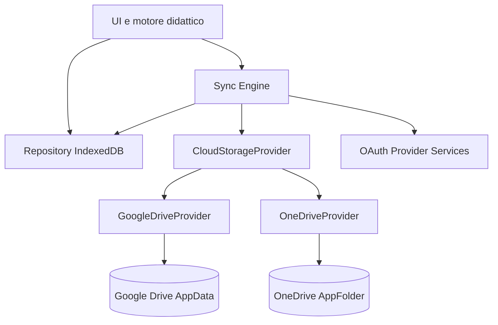
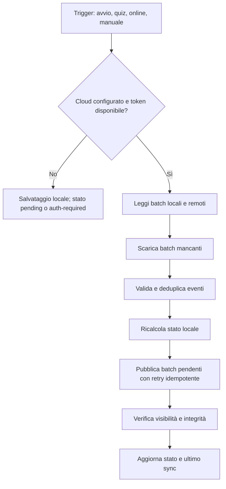

# Patente Tutor — Specifiche funzionali e tecniche: persistenza e sincronizzazione

**Versione:** 1.0  
**Stato:** Specifica di progetto  
**Ambito:** salvataggio locale, Google Drive AppData, Microsoft OneDrive AppFolder

## 1. Obiettivo

Consentire allo studente di utilizzare l'applicazione senza creare un account Patente Tutor e di scegliere una delle seguenti modalità:

- **Solo locale**: dati salvati nel browser tramite IndexedDB, senza autenticazione.
- **Google Drive**: accesso tramite Google OAuth e sincronizzazione nello spazio riservato `appDataFolder`.
- **Microsoft OneDrive**: accesso tramite Microsoft OAuth e sincronizzazione nella cartella applicativa `approot`.

La persistenza locale è sempre attiva ed è la fonte operativa primaria. La sincronizzazione cloud è facoltativa e può essere attivata in seguito senza perdere i progressi.

Non sono previsti database utenti, password applicative o backend per la persistenza.

## 2. Requisiti funzionali

| ID | Requisito | Priorità |
|---|---|---|
| FR-01 | Utilizzo senza registrazione | Must |
| FR-02 | Salvataggio automatico in IndexedDB dopo ogni attività | Must |
| FR-03 | Scelta tra locale, Google e Microsoft | Must |
| FR-04 | Autorizzazione OAuth direttamente con il provider | Must |
| FR-05 | Sincronizzazione bidirezionale | Must |
| FR-06 | Ripristino su browser e dispositivi diversi | Must |
| FR-07 | Funzionamento offline e sincronizzazione successiva | Must |
| FR-08 | Deduplicazione e gestione della concorrenza | Must |
| FR-09 | Migrazione esplicita tra provider | Must |
| FR-10 | Disconnessione senza cancellare i dati locali | Must |
| FR-11 | Export e import JSON | Should |
| FR-12 | Cancellazione separata di dati locali e remoti con conferma | Must |
| FR-13 | Stato e ultimo esito della sincronizzazione visibili | Must |
| FR-14 | Isolamento dei dati in caso di cambio account | Must |

## 3. Esperienza utente

Nelle impostazioni, sezione **Salvataggio e sincronizzazione**, mostrare tre opzioni mutuamente esclusive: locale, Google Drive, Microsoft OneDrive. Locale è l'opzione predefinita.

L'app non richiede autenticazione all'avvio. Quando l'utente seleziona un cloud, si avvia il consenso OAuth. Prima di importare dati remoti preesistenti, verificare che appartengano allo stesso percorso di studio e proporre un merge esplicito se esistono dati locali.

Mostrare gli stati: **Solo locale**, **Sincronizzato**, **Modifiche da sincronizzare**, **Accesso richiesto**, **Errore di sincronizzazione**. Indicare l'ultima sincronizzazione riuscita.

### Primo avvio



## 4. Architettura



Tutta la logica applicativa rimane nel browser. Il catalogo ufficiale dei quiz e gli asset statici non devono essere copiati nel cloud personale: si sincronizzano soltanto progressi, eventi, impostazioni e metadati necessari a ricostruire lo stato.

### Contratti TypeScript

```typescript
type StorageMode = "local" | "google" | "microsoft";

interface CloudIdentity {
  provider: "google" | "microsoft";
  accountId: string;
  displayName?: string;
}

interface CloudStorageProvider {
  readonly type: Exclude<StorageMode, "local">;
  connect(): Promise<CloudIdentity>;
  disconnect(): Promise<void>;
  listBatches(): Promise<RemoteBatchInfo[]>;
  downloadBatch(id: string): Promise<EventBatch>;
  uploadBatch(batch: EventBatch): Promise<void>;
  deleteRemoteData(): Promise<void>;
}

interface LearningEvent {
  id: string;
  deviceId: string;
  studentProfileId: string;
  type: string;
  occurredAt: string;
  schemaVersion: number;
  payload: unknown;
}

interface EventBatch {
  batchId: string;
  schemaVersion: number;
  events: LearningEvent[];
  checksum: string;
}

interface SyncState {
  mode: StorageMode;
  accountId?: string;
  lastSuccessfulSync?: string;
  pendingBatchIds: string[];
  status: "local" | "synced" | "pending" | "auth-required" | "error";
}
```

`RemoteBatchInfo` contiene almeno identificativo remoto, nome, dimensione, checksum se disponibile e metadati necessari a verificare e scaricare il batch.

## 5. Autenticazione e autorizzazione

### Google

- Registrare una **Web application** nella Google Cloud Console e abilitare Google Drive API.
- Usare **Google Identity Services** dal frontend.
- Richiedere esclusivamente `https://www.googleapis.com/auth/drive.appdata`.
- Il client ID pubblico può risiedere nella configurazione frontend; nessun client secret nel browser.
- Usare token di accesso in memoria; non scrivere token nell'archivio sincronizzato.
- Il token model non garantisce il rinnovo silenzioso permanente: gestire la necessità di una nuova autorizzazione.

### Microsoft

- Registrare una **Single Page Application** in Microsoft Entra.
- Usare `@azure/msal-browser`, Authorization Code con PKCE.
- Utilizzare l'endpoint Microsoft Graph `/me/drive/special/approot`.
- Preferire il permesso a privilegi minimi `Files.ReadWrite.AppFolder`, subordinatamente alla verifica della disponibilità e del funzionamento con gli account supportati.
- Non ampliare automaticamente i permessi a `Files.ReadWrite` senza revisione privacy e consenso appropriato.
- Testare account Microsoft personali prima di esporre il provider in produzione.

La scelta del provider cloud non crea un'identità applicativa comune. Lo stesso studente con Google e Microsoft ha archivi distinti finché non avvia una migrazione.

## 6. Persistenza locale

IndexedDB memorizza:

- Storico risposte e sessioni.
- Eventi di apprendimento e identificativi univoci.
- Stato derivato di competenza per argomento e ripassi.
- Preferenze di accessibilità.
- Batch in attesa di upload, registro batch remoti acquisiti e stato di sincronizzazione.
- Identità logica del percorso e metadati di versione schema.

La scrittura locale di attività completate è atomica: la conferma visiva del quiz non deve dipendere dalla disponibilità del cloud.

## 7. Persistenza remota

Ogni provider salva batch di eventi immutabili, anziché aggiornare continuamente un singolo JSON condiviso.

Esempio logico:

```text
application-data/
  batches/
    device-a-batch-001.json
    device-b-batch-002.json
  snapshots/
    snapshot-v3.json          # opzionale
  manifest.json               # opzionale, non autorevole
```

Google AppData è uno spazio applicativo nascosto, non una cartella ordinaria visibile. OneDrive AppFolder è uno spazio riservato all'applicazione nel Drive dell'utente.

### Google Drive API

- Elenco: `GET /drive/v3/files?spaces=appDataFolder` (con paginazione e filtri appropriati).
- Download: `GET /drive/v3/files/{fileId}?alt=media`.
- Creazione batch: `POST /upload/drive/v3/files?uploadType=multipart`, metadata con `parents: ["appDataFolder"]`.
- Eliminazione: `DELETE /drive/v3/files/{fileId}`.

### Microsoft Graph API

- Individuazione cartella: `GET /v1.0/me/drive/special/approot`.
- Elenco, upload, download ed eliminazione con le rispettive operazioni Graph DriveItem.
- Gestione dei limiti dimensionali, throttling e differenze tra account personali e organizzativi.

**Nota:** nomi file uguali non garantiscono unicità su Google Drive. I batch devono includere ID stabili interni, e il motore deve deduplicare anche dopo retry di upload incerti.

## 8. Sincronizzazione

### Regole generali

1. Scrivere sempre prima su IndexedDB.
2. Pubblicare solo batch locali completi e con identificatori stabili.
3. Elencare e scaricare batch remoti non ancora acquisiti.
4. Validare schema, checksum e appartenenza al percorso.
5. Unire eventi per `event.id`; rifiutare collisioni incoerenti.
6. Ricostruire lo stato didattico in modo deterministico.
7. Registrare l'ultimo completamento solo quando le operazioni richieste sono confermate.
8. Non cancellare batch remoti nella normale sincronizzazione.



### Concorrenza e conflitti

Due dispositivi offline possono generare batch diversi e pubblicarli successivamente. Non utilizzare il manifest come lock globale né aggiornare un unico documento come fonte autorevole. Le attività append-only confluiscono nell'insieme di eventi; per preferenze o operazioni di reset, definire regole esplicite di risoluzione basate su eventi versionati. Il timestamp non deve essere usato come unico criterio di verità perché gli orologi possono divergere.

Compattazione e cancellazione di vecchi batch sono fuori dal percorso critico della prima release: devono rispettare dispositivi rimasti offline a lungo.

### Errori

Gestire rete assente, 401/403, quota, throttling 429, 5xx, upload timeout, file malformati e interruzioni. Applicare exponential backoff con jitter quando consentito. Un errore cloud non impedisce di completare quiz o salvare risultati locali.

## 9. Cambio modalità e account

- **Locale → cloud:** autenticazione, controllo archivio remoto, conferma se esistono due percorsi, merge e upload.
- **Cloud → locale:** conservare i dati acquisiti, scollegare e fermare i sync; avvisare se ci sono batch pendenti.
- **Google → Microsoft o viceversa:** sincronizzare prima l'origine, ottenere copia locale verificata, connettere destinazione, caricare, rileggere e confrontare; non cancellare automaticamente l'origine.
- **Cambio account dello stesso provider:** isolare dataset e cache per account; non fondere automaticamente dati di persone differenti.
- **Eliminazione:** funzioni distinte per cancellazione locale, cancellazione cloud, e scollegamento.

L'operazione di migrazione non è completata fino alla verifica del nuovo archivio.

## 10. Sicurezza e privacy

- Nessun account Patente Tutor, nessuna password applicativa, nessun database centrale dei progressi.
- HTTPS in produzione, CSP restrittiva, mitigazione XSS.
- Token gestiti dalle SDK ufficiali e non presenti nei file di backup.
- Richiedere permessi minimi e consenso esplicito.
- Isolare i dati locali per account; evitare leakage nel cambio utente.
- Validare rigorosamente tutti i dati importati, inclusi file recuperati dal cloud.
- Il cloud applicativo non equivale a cifratura end-to-end: valutare cifratura applicativa opzionale.
- Rendere disponibili export e cancellazione; documentare cosa rimane sul dispositivo e nel provider.
- Le analitiche di visita devono restare separate dai dati didattici.

## 11. Limiti operativi

Non è garantita una sincronizzazione continua quando la PWA è chiusa. OAuth può richiedere interazione dopo scadenza/revoca del token. I dati salvati solo localmente possono andare persi se l'utente cancella i dati del sito o cambia browser senza aver sincronizzato o esportato.

Nessun provider garantisce automaticamente merge applicativi: il Sync Engine resta responsabilità del frontend.

## 12. Criteri di accettazione

| ID | Scenario | Risultato atteso |
|---|---|---|
| AT-01 | Primo accesso anonimo | Quiz utilizzabili e salvataggio locale |
| AT-02 | Riavvio dello stesso browser | Progressi conservati |
| AT-03 | Attivazione Google | Backup nello spazio AppData |
| AT-04 | Attivazione Microsoft | Backup nello spazio AppFolder (dopo validazione tecnica) |
| AT-05 | Nuovo dispositivo stesso account | Recupero progressi |
| AT-06 | Due dispositivi offline | Attività mantenute separatamente |
| AT-07 | Entrambi si riconnettono | Unione senza perdita o duplicazione |
| AT-08 | Token scaduto | Quiz funzionanti e stato auth-required |
| AT-09 | Quota o rete non disponibile | Nessuna perdita dati locali |
| AT-10 | Cambio provider | Migrazione verificata senza cancellazione origine |
| AT-11 | Cambio account | Nessun merge silenzioso |
| AT-12 | Elimina cloud | Rimozione solo dopo conferma |
| AT-13 | Export/import | Ripristino completo da JSON valido |

## 13. Struttura del codice suggerita

```text
src/
  storage/
    local/
      IndexedDbRepository.ts
      IndexedDbSchema.ts
    auth/
      GoogleAuthService.ts
      MicrosoftAuthService.ts
    cloud/
      CloudStorageProvider.ts
      GoogleDriveProvider.ts
      OneDriveProvider.ts
    sync/
      SyncEngine.ts
      EventMerger.ts
      BatchManager.ts
      SyncStateRepository.ts
    migration/
      ProviderMigrationService.ts
    models/
      LearningEvent.ts
      EventBatch.ts
      StorageSettings.ts
  features/settings/
    StorageSettingsPage.tsx
    SyncStatusIndicator.tsx
```

## 14. Sequenza implementativa

1. IndexedDB, eventi e migrazione schema.
2. OAuth e Google Drive AppData.
3. Sync Engine incrementale con deduplicazione e recovery.
4. Esperienza utente di collegamento, stato sync, export e cancellazione.
5. OAuth e OneDrive AppFolder, verificando gli account effettivamente supportati.
6. Test di concorrenza, offline, cambio account e provider.

## 15. Riferimenti

- [Google Identity Services — OAuth token model](https://developers.google.com/identity/oauth2/web/guides/use-token-model)
- [Google Drive API — Application Data folder](https://developers.google.com/workspace/drive/api/guides/appdata)
- [Microsoft Graph — OneDrive app folder](https://learn.microsoft.com/en-us/graph/onedrive-sharepoint-appfolder)
- [Microsoft Authentication Library for JavaScript](https://learn.microsoft.com/en-us/entra/msal/javascript/browser/overview)
