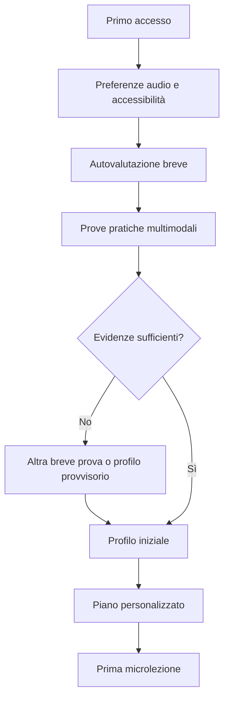
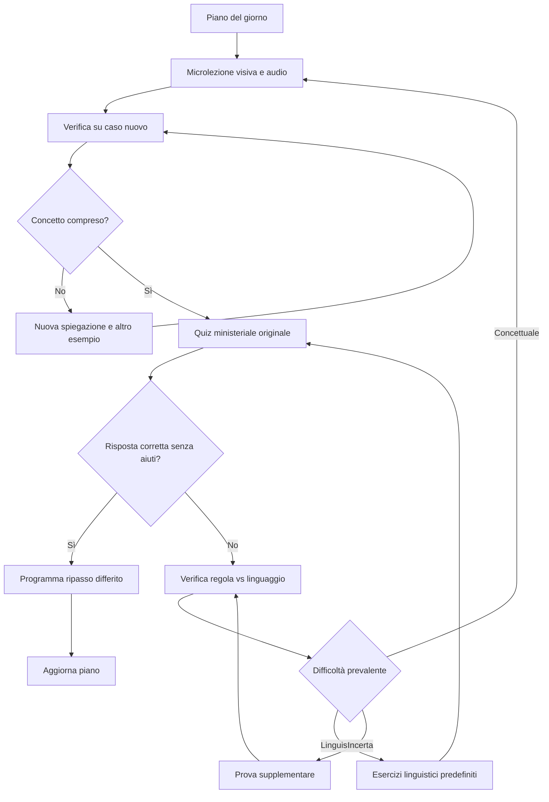
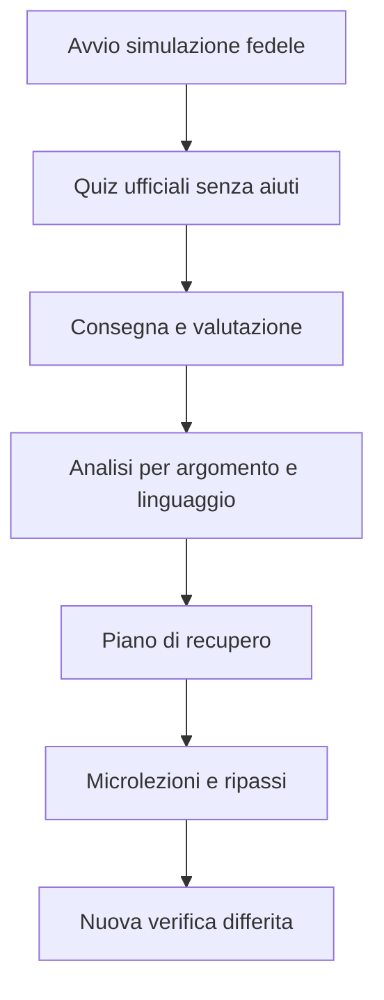
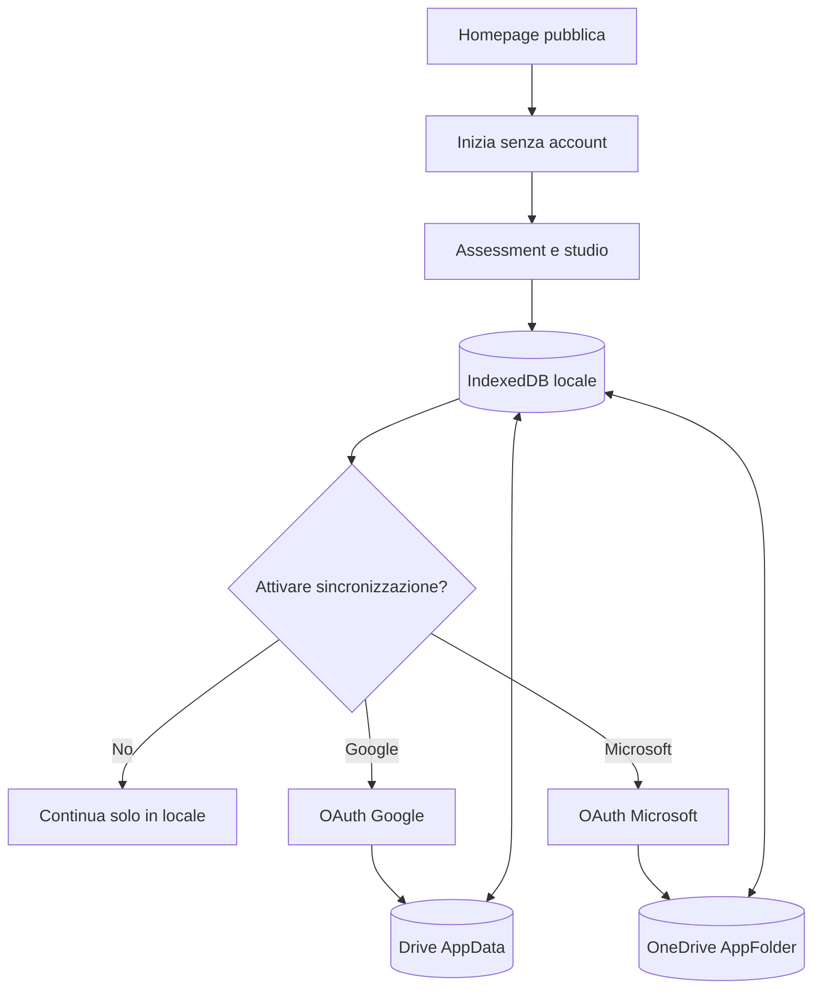

# Specifiche funzionali — Percorso adattivo per la teoria della patente B

**Versione:** 1.2 — 18 ottobre 2026  
**Stato:** proposta funzionale da validare  
**Lingua:** italiano  
**Destinatari:** product owner, UX designer, esperti didattici, sviluppatori, tester

## 1. Visione e obiettivi

Realizzare un'applicazione di studio autonomo per l'esame teorico della patente B italiana, basata sui **quiz ministeriali ufficiali** e progettata per studenti che possono incontrare difficoltà nella lettura e nella comprensione del testo, inclusi studenti con disturbo specifico del linguaggio (DLS). L'applicazione è aperta anche a studenti senza difficoltà note.

Il prodotto non è un semplice simulatore: insegna prima le regole, ne verifica la comprensione attraverso situazioni concrete, allena la decodifica delle formulazioni ministeriali e infine prepara alla prova d'esame senza aiuti.

### 1.1 Obiettivi
- Rendere possibile uno studio **completamente autonomo**, senza questionari obbligatori per genitori o professionisti.
- Distinguere la **conoscenza delle regole** dalla **comprensione linguistica delle domande**.
- Privilegiare contenuti visivi, audio, interattivi e brevi; introdurre progressivamente il testo ministeriale integrale.
- Personalizzare le attività in base a evidenze osservate, non a etichette diagnostiche.
- Ridurre il ricorso a quiz casuali e memorizzazione meccanica delle risposte.
- Misurare la preparazione per argomento e la tenuta nel tempo, senza promettere il superamento dell'esame.

### 1.2 Non obiettivi
- Diagnosticare DLS, DSA o altri disturbi; misurare clinicamente la gravità delle difficoltà.
- Sostituire autoscuola, logopedista o altri professionisti.
- Generare quiz spacciandoli per ufficiali.
- Alterare le domande ufficiali nelle simulazioni d'esame.
- Garantire agevolazioni in sede d'esame: l'idoneità va verificata presso gli enti competenti.

## 2. Fonti ufficiali e vincoli

La banca dati di riferimento è il **listato dei quiz ministeriali per le patenti AB** pubblicato dal Portale dell'Automobilista: https://www.ilportaledellautomobilista.it/ . La pagina ufficiale di pubblicazione e gli eventuali aggiornamenti devono essere registrati nel sistema.

**Vincolo legale:** disponibilità pubblica non significa automaticamente licenza open data. Prima di redistribuire le domande o pubblicare il prodotto, verificare licenza, condizioni di riutilizzo, attribuzione, eventuali restrizioni e modalità di aggiornamento. Non assumere che esista un'API pubblica.

**Vincolo didattico:** conservare testo e risposta ufficiali immutabili. Qualunque semplificazione, audio, spiegazione, illustrazione o esercizio derivato è materiale didattico distinto e chiaramente etichettato.

**Vincolo di attualità:** formato della prova, numero di domande, durata, soglia errori e possibili accomodamenti devono essere configurabili e verificati contro la disciplina vigente prima del rilascio. Valori operativi iniziali per patente B: 30 domande, 20 minuti, massimo 3 errori, **da riconfermare**.

## 3. Utenti e ruoli

### 3.1 Studente (ruolo primario)
- Accede senza registrazione né account applicativo; può scegliere facoltativamente Google o Microsoft solo per sincronizzare i dati.
- Completa in autonomia un assessment iniziale non diagnostico.
- Segue un piano giornaliero guidato.
- Usa audio, immagini, interazioni e quiz ufficiali.
- Visualizza progressi e difficoltà senza etichette stigmatizzanti.
- Può interrompere e riprendere qualsiasi sessione di studio.

### 3.2 Amministratore contenuti
- Importa e versiona i quiz ufficiali.
- Revisiona tassonomie, spiegazioni, immagini, associazioni e qualità degli esercizi.
- Pubblica nuovi pacchetti dopo controlli.
- Gestisce segnalazioni di contenuti ambigui o errati.

### 3.3 Esperto revisore (opzionale, back office)
- Valida spiegazioni normative e adattamenti linguistici.
- Valida la progettazione delle prove di comprensione e l'accessibilità.
- Non è coinvolto obbligatoriamente nel percorso del singolo studente.

Non è prevista una dashboard genitore obbligatoria nell'MVP; eventuale condivisione dei progressi è volontaria e controllata dallo studente.

## 4. Principi di esperienza utente

1. **Autonomia:** niente supervisione richiesta per iniziare o continuare.
2. **Nessuna diagnosi richiesta:** le preferenze e le difficoltà possono essere indicate facoltativamente.
3. **Audio sempre disponibile:** comandi di ascolto visibili e coerenti, senza riproduzione forzata.
4. **Una richiesta alla volta:** schermate focalizzate, istruzioni brevi e prevedibili.
5. **Visuale prima del verbale:** immagini e situazioni pratiche quando aiutano a comprendere la regola.
6. **Testo originale sempre raggiungibile:** l'utente deve poter vedere la formulazione ministeriale.
7. **Aiuti trasparenti:** l'app distingue risposte autonome da risposte ottenute con suggerimenti.
8. **Errori non punitivi:** feedback sul concetto da migliorare, non sul valore della persona.
9. **Progressione graduata:** supporti progressivamente ridotti verso le condizioni reali d'esame.
10. **Accessibilità:** font leggibile, dimensione regolabile, buon contrasto, target tattili ampi, navigazione da tastiera e compatibilità con screen reader.

## 5. Percorso utente end-to-end

1. Benvenuto e spiegazione breve di come funziona l'app.
2. Impostazioni iniziali facoltative: volume, velocità audio, dimensione testo, preferenze di accessibilità.
3. Autovalutazione percepita (circa 3 minuti).
4. Assessment pratico adattivo (circa 10–15 minuti, interrompibile).
5. Profilo iniziale **provvisorio** con livello di confidenza, non diagnostico.
6. Piano personalizzato e prima microlezione.
7. Studio → verifica concettuale → allenamento linguistico → quiz ministeriali → ripasso.
8. Introduzione progressiva delle simulazioni complete.
9. Revisione degli errori e piano di recupero.
10. Aggiornamento continuo del profilo e della pianificazione.

## 6. Assessment iniziale autonomo

### 6.1 Finalità
Stimare, con cautela, il livello di conoscenza della patente, la comprensione di consegne scritte e orali, l'utilità degli aiuti visivi e audio, e le difficoltà con specifiche strutture linguistiche. **Non produce diagnosi né punteggi clinici.**

### 6.2 Autovalutazione (FR-AS-01)
- 5–8 domande brevi, ascoltabili, una per schermata.
- Risposte a scelta con linguaggio semplice e possibilità di “non so”.
- Aree: abitudine allo studio, comprensione di testi lunghi, lettura ripetuta, uso di immagini/audio, gestione del tempo, ansia percepita nei quiz, familiarità con la patente.
- Possibilità di saltare una domanda; nessun obbligo di dichiarare condizioni sanitarie.
- Le risposte influenzano solo la configurazione iniziale, mai l'esclusione da attività.

### 6.3 Prove pratiche (FR-AS-02)
L'app presenta brevi esercizi equivalenti ma non identici in modalità diverse, controbilanciando ordine e difficoltà:
- **Visuale:** scena stradale con domanda concreta.
- **Orale:** consegna ascoltata senza testo, quando appropriato.
- **Testuale semplice:** frase breve su una regola.
- **Testuale ministeriale:** formulazione ufficiale integrale.
- **Linguistica:** negazioni, eccezioni, quantificatori, verbi modali, termini simili e subordinate.
- **Conoscenza:** regole già note vs regole non ancora apprese.

L'app misura risposta, correttezza, tempo orientativo, riascolti, richieste di aiuto e cambi di risposta; i tempi non sono interpretati da soli come indicatori di difficoltà. Non mostra classifiche o esiti “promosso/bocciato”.

### 6.4 Adattività dell'assessment (FR-AS-03)
- Le prove successive sono selezionate per chiarire un'ipotesi, non per ripetere identica domanda.
- Se una difficoltà emerge solo nel testo, proporre una verifica concettuale visiva e una linguistica separata.
- Se l'utente mostra stanchezza o interrompe, salvare lo stato e offrire una ripresa.
- Se i dati sono insufficienti, indicare “da verificare” anziché assegnare una percentuale apparentemente precisa.
- Durata indicativa totale: 15–20 minuti, suddivisibile.

### 6.5 Risultato (FR-AS-04)
Profilo iniziale distinto per:
- conoscenza per argomento;
- comprensione di formulazioni ministeriali;
- strutture linguistiche critiche;
- supporti risultati utili nel contesto osservato;
- affidabilità delle stime e dati ancora mancanti.

Esempio di messaggio: “Con le immagini riconosci bene i segnali. Alcune frasi con ‘eccetto’ richiedono più attenzione. Iniziamo con esercizi brevi su queste frasi.” Evitare etichette come “deficit linguistico 42%”.

### 6.6 Criteri di accettazione
- L'assessment è completabile senza genitore, tutor o diagnosi dichiarata.
- Ogni consegna può essere ascoltata e ripetuta.
- È possibile sospendere e riprendere senza perdita di risposte.
- Una singola risposta errata non determina un'etichetta permanente.
- Il risultato propone immediatamente un'attività concreta.

## 7. Catalogo ministeriale e tassonomie

### 7.1 Importazione (FR-CT-01)
- Acquisire file ufficiali da fonte autorizzata e tracciabile.
- Registrare URL, data di acquisizione, data/versione della fonte, hash, formato e stato della licenza.
- Estrarre identificativo, testo originale, soluzione V/F, eventuali immagini e riferimenti disponibili.
- Verificare completezza, unicità, encoding, caratteri speciali e associazione risposta-domanda.
- Mettere in quarantena record incompleti o ambigui.
- Non pubblicare nuovi pacchetti senza controllo di qualità.

### 7.2 Classificazione didattica (FR-CT-02)
Ogni quiz può appartenere a più categorie:
- **Argomento:** segnali, precedenze, velocità, distanze, fermata/sosta, comportamento, documenti, sicurezza, ecc.
- **Concetto normativo:** regola atomica verificata dalla domanda.
- **Difficoltà linguistica:** negazione, doppia negazione, eccezione, assoluti, condizioni, lessico tecnico, termini confondibili, frase lunga.
- **Prerequisiti:** concetti da conoscere prima.
- **Tipo di errore frequente:** confusione normativa, interpretazione lessicale, lettura superficiale, altro/non determinato.

La classificazione automatica, se usata, richiede revisione e controlli a campione; i contenuti normativi critici necessitano validazione editoriale.

### 7.3 Tracciabilità (FR-CT-03)
Da ogni quiz l'amministratore può risalire a fonte, versione, argomenti, concetti, spiegazioni approvate e modifiche. Il testo ministeriale è immutabile per versione.

## 8. Motore delle microlezioni

### 8.1 Struttura (FR-LN-01)
Ogni microlezione dura indicativamente 5–12 minuti e include:
1. obiettivo in linguaggio semplice;
2. una regola o pochi concetti correlati;
3. spiegazione audio con illustrazione o animazione pertinente;
4. esempio guidato;
5. applicazione autonoma in un caso nuovo;
6. breve controllo di comprensione;
7. introduzione al testo ministeriale corrispondente.

### 8.2 Presentazione multimodale (FR-LN-02)
- Audio sincronizzabile con evidenziazione di brevi segmenti di testo.
- Velocità di riproduzione regolabile e replay di una singola frase.
- Immagini stradali corrette e prive di ambiguità didattiche.
- Glossario contestuale con parole come “salvo”, “in prossimità”, “fermata”, “sosta”, “deve”, “può”.
- Trascrizione testuale accessibile di ogni contenuto audio.
- Alternativa statica alle animazioni.

### 8.3 Verifica concettuale (FR-LN-03)
L'app chiede di ordinare veicoli, selezionare segnali, individuare comportamenti consentiti o spiegare una scelta. Non basta ricordare una frase: almeno un esercizio deve trasferire la regola a un esempio nuovo.

### 8.4 Aiuti graduati (FR-LN-04)
Livelli: spiegazione completa → indizio → sola domanda → quiz ministeriale senza aiuti. La risposta con indizio non vale come prova equivalente a una risposta autonoma.

## 9. Tutor linguistico

### 9.1 Scomposizione delle domande (FR-LG-01)
In modalità studio, il testo ministeriale può essere affiancato da:
- segmentazione in parti;
- evidenziazione di negazioni e condizioni;
- glossario di termini tecnici;
- parafrasi semplice, marcata come **spiegazione didattica non ufficiale**;
- rappresentazione visuale del significato.

### 9.2 Allenamento mirato (FR-LG-02)
Percorsi su “non/mai”, “salvo/eccetto”, “sempre/solo”, “può/deve”, “fermata/sosta”, subordinate e quantificatori. Esercizi brevi con difficoltà crescente e casi diversi da quelli appena visti.

### 9.3 Rimozione progressiva dei supporti (FR-LG-03)
Quando la comprensione migliora, l'app propone più domande in formulazione originale senza evidenziazioni. Gli aiuti restano disponibili nello studio, ma non nella simulazione fedele.

### 9.4 Distinzione delle cause (FR-LG-04)
L'app non presume la causa dell'errore. Usa risposte su casi equivalenti per stimare se occorra ripassare la regola, la formulazione o entrambe. Se l'evidenza è ambigua, propone una breve verifica supplementare.

## 10. Catalogo di esercizi predefiniti (nessuna AI)

### 10.1 Contenuti editoriali (FR-EX-01)
- Tutte le microlezioni, immagini, tracce audio, spiegazioni, domande, risposte, feedback e percorsi sono progettati e verificati **a priori** e distribuiti come asset statici del frontend.
- Ogni esercizio ha identificativo stabile, argomento, difficoltà, prerequisiti, caratteristiche linguistiche, soluzione e feedback predefiniti.
- Nessun esercizio, spiegazione, giudizio o risposta viene generato dinamicamente da AI o servizi esterni.
- Il sistema seleziona esclusivamente attività esistenti nel catalogo e applica regole deterministiche.

### 10.2 Accessibilità e audio (FR-EX-02)
- Comandi «Ascolta», «Ripeti», «Mostra immagine» e «Semplifica» attivano soltanto risorse predefinite o, ove compatibile, la sintesi vocale locale del dispositivo/browser.
- Nessun audio o testo dello studente viene trasmesso a servizi di riconoscimento vocale, LLM o API remote.
- L'interazione primaria è tramite pulsanti, selezioni e risposte chiuse, valutabili con criteri predeterminati.

### 10.3 Feedback (FR-EX-03)
- Per ogni risposta il feedback è associato in fase editoriale all'esercizio o a una categoria di errore codificata.
- Se la causa dell'errore non è deducibile, mostrare «Da verificare» e proporre un altro esercizio predefinito, senza attribuire diagnosi o interpretazioni non dimostrate.

## 11. Quiz ufficiali per argomento

### 11.1 Sessione (FR-QZ-01)
Dopo la comprensione guidata, presentare quiz ministeriali originali pertinenti al concetto, con testo e soluzione intatti. Possibilità di ascolto in modalità studio, senza attribuire alla riproduzione audio lo status di agevolazione prevista all'esame.

### 11.2 Feedback (FR-QZ-02)
Dopo ogni risposta: esito, regola pertinente, spiegazione breve, eventuale visualizzazione e opportunità di esercizio su un caso equivalente. Evitare di riproporre subito lo stesso item come unica prova di acquisizione.

### 11.3 Analisi errore (FR-QZ-03)
Registrare se la risposta è stata data con aiuti, tempi orientativi, eventuale riascolto, argomento, struttura linguistica e verifiche successive. La classificazione della causa resta un'ipotesi finché non confermata.

## 12. Motore adattivo e modello dello studente

### 12.1 Dimensioni (FR-AD-01)
Mantenere separatamente per ogni studente:
- padronanza stimata dei concetti normativi;
- comprensione delle formulazioni linguistiche;
- stabilità nel tempo;
- autonomia della risposta (con/senza aiuti);
- copertura del programma;
- incertezza delle stime.

### 12.2 Aggiornamento (FR-AD-02)
Aggiornare il profilo dopo attività significative. Ponderare maggiormente risposte indipendenti su esempi nuovi e ripetizioni differite; ponderare meno risposte con indizi o a domande appena viste. Non usare percentuali come probabilità cliniche o di promozione senza validazione empirica.

### 12.3 Scelta dell'attività (FR-AD-03)
Priorità: lacune fondamentali → ripassi in scadenza → difficoltà linguistiche ricorrenti → nuovi argomenti → verifica in condizioni d'esame. Bilanciare carico e varietà; consentire una scelta manuale senza perdere il piano suggerito.

### 12.4 Spaced repetition (FR-AD-04)
Ripassi indicativi dopo 1, 3, 7 e 14 giorni, adattabili in base agli esiti. Usare varianti equivalenti e non solo ripetizione letterale del quiz.

### 12.5 Regole di avanzamento (FR-AD-05)
Non sbloccare la simulazione come unica ricompensa; le simulazioni possono essere disponibili come verifica diagnostica anche prima della piena copertura, con avviso che il risultato non rappresenta la preparazione completa. La progressione ordinaria privilegia prima lo studio guidato.

## 13. Piano giornaliero e motivazione

### 13.1 Dashboard dello studente (FR-PL-01)
Mostrare “Cosa facciamo oggi?”, durata stimata 10–15 minuti, massimo tre attività principali, pulsante “Inizia” e “Riprendi”. Evitare schermate iniziali piene di statistiche.

### 13.2 Piano (FR-PL-02)
Il piano contiene un nuovo concetto, un ripasso e, quando utile, un breve esercizio linguistico. Può essere ridotto a una sessione da 5 minuti. Le interruzioni non azzerano i progressi.

Mostrare anche una traccia di massima delle attività successive, chiarendo che contenuti e tempi possono cambiare in base ai risultati ottenuti. I giorni proposti sono indicativi: lo studente può iniziare in anticipo la prima attività non completata, mentre le attività successive restano bloccate per preservare la sequenza del percorso.

### 13.3 Feedback motivazionale (FR-PL-03)
Riconoscere concetti compresi, autonomia crescente e continuità, senza classifiche pubbliche o penalizzazioni per assenze. Evitare promesse o stime non validate del successo all'esame.

## 14. Simulazione d'esame

### 14.1 Modalità fedele (FR-EX-01)
- Domande ufficiali e risposte originali.
- Parametri d'esame aggiornabili da configurazione validata.
- Timer, navigazione e conclusione coerenti con le regole applicabili.
- Nessuna parafrasi, indizio, glossario o feedback durante la prova.
- Nella simulazione sono utilizzati soltanto quiz ministeriali originali.

### 14.2 Modalità accessibile di allenamento (FR-EX-02)
Offrire separatamente una simulazione con supporti configurabili (es. lettura audio), chiaramente etichettata **allenamento assistito, non replica garantita delle condizioni d'esame**. Non presumere che le medesime misure siano concesse in sede ufficiale.

### 14.3 Debrief (FR-EX-03)
Mostrare esito, errori per argomento e strutture linguistiche, differenze rispetto alle simulazioni precedenti, e tre attività mirate per la sessione successiva. Non dedurre automaticamente un disturbo da un pattern di errori.

### 14.4 Prontezza (FR-EX-04)
Indicatore descrittivo basato su copertura, consolidamento e risultati recenti in prove fedeli. Nessuna “probabilità di promozione” numerica finché non esiste un modello validato su dati reali.

## 15. Importazione delle schede degli esami precedenti

### 15.1 Funzione opzionale (FR-HS-01)
Lo studente può importare volontariamente le schede degli esami sostenuti, quando disponibili tramite i canali ufficiali. L'importazione può avvenire tramite file o inserimento manuale; eventuale lettura automatica richiede conferma dei dati estratti.

### 15.2 Uso (FR-HS-02)
Associare gli errori ai concetti e alle strutture linguistiche, se le domande sono identificabili con sufficiente certezza. Se non lo sono, non inventare corrispondenze. Le schede pregresse sono segnali iniziali, non diagnosi né prova conclusiva delle cause delle bocciature.

## 16. Schermate principali

| Schermata | Contenuti e azioni principali |
|---|---|
| Homepage pubblica | Obiettivi, funzionamento, promessa privacy verificabile, avvio senza login |
| Preferenze | Audio, velocità, dimensione testo, accessibilità |
| Autovalutazione | Domande brevi, ascolta, salta, avanti/indietro |
| Assessment pratico | Un esercizio per volta, replay, pausa |
| Profilo iniziale | Punti di forza osservati, aspetti da verificare, primo passo |
| Home | Attività di oggi, durata, riprendi |
| Microlezione | Audio, immagine, esempio, prova autonoma |
| Tutor linguistico | Quiz originale, segmentazione, glossario, esercizi |
| Quiz per argomento | V/F ministeriale, feedback, spiegazione |
| Simulazione | Timer, navigazione, risposte, invio |
| Risultati | Errori raggruppati, ripassi consigliati |
| Progressi | Concetti acquisiti, da consolidare, dati insufficienti |
| Impostazioni/privacy | Consensi, dati, esportazione, cancellazione |
| Back office | Import, revisione, pubblicazione, audit |

## 17. Dati funzionali principali

- **StudentProfile:** preferenze, progressi, configurazione accessibilità, consensi.
- **AssessmentSession / AssessmentItem / AssessmentResponse:** versione prova, modalità, risposta, aiuti, eventi rilevanti.
- **OfficialQuestion:** ID, testo, risposta, media, fonte, versione, stato validazione.
- **Topic / Concept / Prerequisite:** tassonomia e relazioni.
- **LanguageFeature:** struttura linguistica e difficoltà associate.
- **QuestionMapping:** associazioni quiz–concetti–strutture, stato revisione.
- **Lesson / Exercise:** contenuti didattici versionati, indicazione di origine.
- **LearningAttempt:** risposta, modalità, aiuti, valutazione, timestamp.
- **MasteryEstimate:** dimensione, stima, confidenza, ultima verifica.
- **ReviewSchedule:** prossima ripetizione e motivazione.
- **ExamSimulation / ExamResponse:** parametri, quesiti, risposte, esito.
- **ContentRelease / AuditLog:** versione pubblicata, fonte e modifiche.

## 18. Requisiti non funzionali con impatto funzionale

### 18.1 Accessibilità
Obiettivo di progettazione: WCAG 2.2 AA per le interfacce applicabili, da verificare con audit e test reali. Non usare il solo colore per comunicare risultati. Evitare testo incorporato nelle immagini senza alternativa accessibile. Fornire controllo di animazioni e audio.

### 18.2 Privacy e assenza di archiviazione centralizzata
Nessun account Patente, database utenti o archivio centrale di progressi, assessment e risposte. Salvataggio locale nel browser tramite IndexedDB come default. La sincronizzazione è facoltativa e usa esclusivamente lo spazio applicativo privato del provider scelto (Google Drive AppData o Microsoft OneDrive AppFolder), secondo le specifiche della sezione 26. Non richiedere diagnosi. Nessuna elaborazione remota AI/voce, nessun backend applicativo e nessun invio dei risultati di studio a server gestiti dal prodotto. La sola eccezione al funzionamento locale è la sincronizzazione facoltativa direttamente dal browser verso il provider Google o Microsoft scelto dall’utente. Evitare analytics identificanti, tracker pubblicitari e invio di dati di studio a sistemi di telemetria. Definire informativa, eventuali basi giuridiche, retention dei fornitori, sicurezza, cancellazione e valutazione d'impatto ove necessaria.

### 18.3 Affidabilità dei contenuti
I contenuti normativi devono avere una fonte e una versione. Se una domanda ufficiale cambia, mantenere lo storico senza mischiare versioni nei risultati. Prevedere rollback del pacchetto pubblicato.

### 18.4 Prestazioni e continuità
Salvataggio automatico dopo ogni risposta; ripresa di sessioni interrotte; caricamento rapido di schermate, audio e immagini. Le attività supportate da asset già scaricati devono funzionare offline; la sola sincronizzazione cloud richiede connessione.

### 18.5 Trasparenza
Distinguere sempre “domanda ministeriale”, “spiegazione didattica”, “esercizio generato” e “simulazione fedele”. Segnalare quando una stima è preliminare o incerta.

## 19. Casi d'uso esemplificativi

### UC-01 — Comprende visivamente ma sbaglia la frase
1. Lo studente risolve correttamente un incrocio visuale.
2. Sbaglia un quiz ufficiale sul medesimo concetto.
3. Il sistema propone una frase equivalente con lessico più semplice.
4. Se la comprende, propone un esercizio linguistico mirato.
5. Ripresenta successivamente un nuovo quiz ministeriale senza aiuti.
6. Registra separatamente conoscenza della regola e comprensione linguistica.

### UC-02 — Memorizza la risposta ma non la regola
1. Risponde correttamente a un quiz già incontrato.
2. Sbaglia una nuova situazione equivalente.
3. Il sistema non considera consolidato il concetto.
4. Propone una microlezione e un esempio di trasferimento.

### UC-03 — Richiede più volte l'audio
1. Ascolta due volte una domanda durante lo studio.
2. Il sistema registra l'uso dell'aiuto senza penalizzarlo automaticamente.
3. Propone una verifica successiva con testo più breve e un'altra con testo originale.
4. Aggiorna il profilo solo se emergono evidenze coerenti.

### UC-04 — Quattro esami precedenti
1. Lo studente importa le schede disponibili.
2. L'app riconosce solo le domande associabili con certezza.
3. Mostra argomenti ricorrenti da verificare.
4. Avvia un assessment mirato senza presupporre la causa degli errori.

### UC-05 — Simulazione non superata
1. Conclude la simulazione con errori oltre la soglia configurata.
2. L'app mostra il risultato senza giudizi personali.
3. Raggruppa gli errori per concetto e caratteristiche linguistiche.
4. Genera un piano breve per il giorno successivo.

## 20. Priorità di rilascio

### MVP — P0
- Import/versionamento di un pacchetto ufficiale validato e verifica licenza.
- Tassonomia essenziale di argomenti e caratteristiche linguistiche.
- Autovalutazione autonoma e assessment pratico di base.
- Profilo iniziale provvisorio.
- Microlezioni multimediali per un insieme pilota di argomenti.
- Tutor linguistico con glossario e segmentazione approvati.
- Quiz ministeriali per argomento, spiegazioni validate.
- Piano giornaliero e ripasso dilazionato semplice.
- Simulazione fedele e report errori.
- Homepage pubblica, informativa privacy e scelta di archiviazione locale/cloud facoltativa.
- IndexedDB locale, gestione dati e nessun account proprietario.
- Accessibilità di base, privacy, tracciabilità contenuti.

### Release 1.1 — P1
- Assessment adattivo più sofisticato con stime di confidenza.
- Ampliamento del catalogo editoriale di esercizi e percorsi predefiniti.
- Voce in input e output con gestione trascrizioni.
- Importazione schede esami precedenti.
- Motore di raccomandazione personalizzato più avanzato.
- Dashboard progressi con analisi longitudinali.

### Evoluzioni — P2
- Ampia libreria di scenari interattivi e animazioni.
- Esperimenti controllati sulle strategie didattiche.
- Modalità offline.
- Condivisione facoltativa dei progressi.
- Estensione ad altre categorie di patente previa validazione dei contenuti.

## 21. Metriche di efficacia

### Metriche di prodotto
- Percentuale di assessment completati senza assistenza.
- Percentuale di sessioni completate o riprese.
- Frequenza di uso degli aiuti audio e linguistici.
- Copertura del programma per concetti, non solo per numero di quiz.
- Tasso di risposte corrette su esempi **nuovi**.
- Mantenimento delle conoscenze a distanza di giorni.
- Miglioramento nelle simulazioni fedeli nel tempo.

### Metriche di qualità
- Percentuale di quiz con mappatura verificata.
- Numero di errori editoriali segnalati e risolti.
- Accuratezza del riconoscimento vocale su campioni consensuali e rappresentativi.
- Comprensibilità delle microlezioni misurata con test utente.
- Differenza tra prestazioni con supporti e senza supporti, senza interpretazioni cliniche automatiche.

### Validazione
Testare il prototipo con utenti rappresentativi, inclusi studenti con difficoltà linguistiche, e coinvolgere competenze di logopedia/didattica inclusiva per valutare strumenti e materiali. La validazione deve misurare apprendimento reale, non solo gradimento o quiz ripetuti.

## 22. Criteri generali di accettazione

1. Uno studente nuovo completa il percorso iniziale senza assistenza esterna.
2. La valutazione non richiede né produce diagnosi.
3. L'app distingue testo ministeriale originale e contenuti di supporto.
4. Un errore linguistico non comporta automaticamente il ripasso dell'intero argomento.
5. Una risposta corretta a una domanda già vista non basta a consolidare una regola.
6. Gli aiuti sono disponibili nello studio ma assenti nella simulazione fedele.
7. Le risposte ufficiali non sono modificate da AI o redattori.
8. Ogni domanda ufficiale è riconducibile alla sua versione e fonte.
9. Lo studente può sospendere e riprendere una sessione.
10. Il sistema produce attività successive comprensibili e motivate dagli errori osservati.
11. Gli errori e i dati di apprendimento possono essere cancellati secondo le regole privacy definite.
12. Il prodotto non dichiara di riprodurre accomodamenti d'esame non verificati.

## 23. Rischi e questioni aperte

| Tema | Rischio / decisione da prendere |
|---|---|
| Licenza quiz | Accertare riutilizzo e redistribuzione dei listati ministeriali |
| Aggiornamenti | Definire controllo periodico della fonte e procedura di pubblicazione |
| Accuratezza didattica | Validare spiegazioni e scenari visivi con revisori competenti |
| Profilazione | Evitare inferenze cliniche e metriche ingannevolmente precise |
| Regole adattive | Testare soglie, progressioni e assenza di percorsi bloccati |
| Audio | Verificare disponibilità degli asset e compatibilità della sintesi vocale locale |
| Misure d'esame | Verificare norme aggiornate e applicabilità di eventuali accomodamenti |
| Minori | Stabilire requisiti specifici se l'app è utilizzabile da minorenni |
| Modello economico | Chiarire uso personale, pubblico gratuito o commerciale prima della distribuzione |

## 24. Flussi funzionali

### 24.1 Onboarding e assessment

### 24.2 Ciclo di apprendimento

### 24.3 Simulazione e recupero

## 25. Prossimi deliverable

1. Inventario e verifica della banca dati ministeriale con licenza e struttura effettiva.
2. Tassonomia completa argomenti × caratteristiche linguistiche.
3. Disegno dettagliato dell'assessment con item, scoring prudente e regole adattive.
4. Wireframe delle schermate essenziali e test di comprensibilità.
5. Specifiche tecniche separate: architettura frontend-only, modello dati locale, pipeline offline di importazione, algoritmo deterministico, sicurezza, OAuth diretto e sincronizzazione provider.
6. Piano di validazione con criteri misurabili e revisione specialistica.

## 26. Homepage pubblica, onboarding e promessa di riservatezza

### 26.1 Scopo e accessibilità (FR-LP-01)
- La **homepage pubblica** è la prima schermata alla prima visita, prima dell'assessment e prima di qualsiasi richiesta di autenticazione.
- Nessun login, consenso cloud o inserimento di dati personali è necessario per leggere la homepage o iniziare lo studio in modalità locale.
- Linguaggio breve, chiaro e rassicurante, con supporto alla lettura vocale, layout mobile-first, alto contrasto e assenza di termini tecnici non spiegati.
- Distinguere nettamente questa homepage informativa dalla **dashboard dello studente** descritta al §13.1.

### 26.2 Messaggi obbligatori (FR-LP-02)
La pagina deve spiegare, in termini comprensibili anche a studenti con difficoltà linguistiche:
1. **Obiettivo:** aiutare a capire le regole della strada e il linguaggio dei quiz ministeriali, non imparare risposte a memoria.
2. **Metodo:** breve valutazione autonoma iniziale, microlezioni con immagini e audio, esercizi progressivi, ripasso e simulazioni fedeli all'esame.
3. **Destinatari:** tutti gli studenti; supporti accessibili disponibili senza obbligo di dichiarare diagnosi.
4. **Dati:** i progressi restano nel browser per impostazione predefinita; l'app non crea account proprietari né conserva una copia centrale dei progressi.
5. **Cloud facoltativo:** solo su scelta esplicita, i dati vengono copiati nell'area privata dedicata all'app dell'account Google o Microsoft dello studente.
6. **Controllo:** esportazione, importazione e cancellazione dei dati; avviso che la cancellazione dei dati locali e cloud sono operazioni distinte.
7. **Limiti:** svuotare i dati del browser può cancellare i progressi locali non sincronizzati; nessuna garanzia di superamento dell'esame.
8. **Nessuna AI o backend:** tutte le valutazioni e i percorsi sono calcolati nel browser su contenuti e regole predefiniti.

### 26.3 Struttura consigliata (FR-LP-03)
- **Hero:** «Non memorizzare le risposte. Impara a capire la strada.» e CTA primaria «Inizia senza account».
- **Come funziona:** quattro passi illustrati (scopri come impari, capisci, esercitati, preparati all'esame).
- **Accessibilità:** ascolto delle spiegazioni, immagini, linguaggio semplificato e passaggio graduale al testo ministeriale.
- **Privacy in evidenza:** «I tuoi progressi rimangono sul tuo dispositivo. Se vuoi, li sincronizzi sul tuo Google Drive o OneDrive. Non abbiamo un archivio dei tuoi risultati.»
- **FAQ:** «Devo registrarmi?», «Dove sono i miei dati?», «Se cambio dispositivo?», «Cosa succede se cancello il browser?», «Come elimino i dati?», «L'AI vede le mie risposte?».
- **Footer:** Informativa privacy, dettagli tecnici di archiviazione, contatti, provenienza dei quiz ministeriali e condizioni d'uso.
- Non inserire cookie banner non necessari: mostrarlo solo se effettivamente richiesto dalle tecnologie adottate.
- Dichiarare Vercel Web Analytics come unico strumento di misurazione delle visite, configurato senza cookie di tracciamento, senza pubblicità o profilazione e senza eventi contenenti dati dello studente. Rimandare all’informativa per gli eventuali trattamenti tecnici del fornitore.

### 26.4 Prima esecuzione (FR-ON-01)
1. Visita homepage senza account.
2. Clic su «Inizia senza account».
3. Breve messaggio: «Salveremo i progressi solo in questo browser. Potrai scegliere Google o Microsoft più avanti».
4. Avvio assessment autonomo, con opzione «Ascolta» e pausa/ripresa.
5. Creazione automatica di un profilo di studio **locale** in IndexedDB; nessun identificativo remoto richiesto.
6. Possibilità di scegliere in seguito «Attiva sincronizzazione» nelle impostazioni, senza perdere i progressi locali.

### 26.5 Criteri di accettazione homepage
- Un nuovo visitatore può comprendere obiettivi, metodo e trattamento dei progressi senza autenticarsi.
- Il pulsante di avvio funziona senza provider OAuth e senza connessione a un backend utenti.
- Nessuna schermata obbliga a selezionare Google o Microsoft.
- Le affermazioni privacy sono verificabili rispetto ai flussi di rete e ai fornitori effettivamente utilizzati.
- Non esistono integrazioni AI/voce remote né endpoint applicativi che ricevano risposte o progressi.

## 27. Salvataggio locale e sincronizzazione facoltativa Google/Microsoft

### 27.1 Principi e modalità (FR-DATA-01)
- **Solo locale (predefinita):** assessment, risposte, progressi, piano, ripassi e preferenze salvati in IndexedDB del browser; nessun account richiesto.
- **Google Drive AppData:** dopo autorizzazione OAuth diretta con Google, copia e sincronizzazione nell'area `appDataFolder` dell'account selezionato; usare scope minimo `drive.appdata`.
- **Microsoft OneDrive AppFolder:** dopo autorizzazione OAuth con Microsoft, sincronizzazione nella cartella applicativa dedicata tramite Microsoft Graph `approot`; permessi minimi effettivi da verificare in implementazione, incluso il supporto dello scope `Files.ReadWrite.AppFolder` per il tipo di account target.
- Nessun provider di identità intermedio (es. Clerk) obbligatorio e nessun account applicativo centralizzato.
- La scelta del provider non trasferisce la proprietà dei dati all'applicazione: restano nel browser e/o nello spazio del provider scelto.

### 27.2 Flusso OAuth (FR-DATA-02)
- Attivazione **solo con gesto esplicito** dello studente («Collega Google» / «Collega Microsoft»).
- Apertura del consenso ufficiale del provider, usando librerie ufficiali e OAuth 2.0 con PKCE ove applicabile a SPA.
- Richiedere soltanto i permessi indispensabili per l'area dati dell'app; non richiedere accesso generale a Drive/OneDrive o profilo esteso senza necessità.
- Nessun token nei file di backup o nel cloud; evitare localStorage per token sensibili e non registrarli nei log. Gestire scadenza, revoca e nuova autorizzazione.
- Il collegamento OAuth serve esclusivamente per accedere all'archivio cloud scelto, non per creare un'identità applicativa.

### 27.3 Sincronizzazione (FR-DATA-03)
- Salvataggio locale immediato; sync in background quando disponibile la connessione e l'autorizzazione.
- Ripristino su nuovo browser/dispositivo dopo nuova autorizzazione con lo stesso account provider.
- Sincronizzazione bidirezionale con schema versionato, revisioni, controllo integrità e gestione di modifiche concorrenti.
- In caso di conflitto non risolvibile in modo sicuro, conservare entrambe le versioni e chiedere una scelta comprensibile, senza perdita silenziosa.
- Mostrare stato: «Solo su questo dispositivo», «Sincronizzato», «Da sincronizzare», «Sincronizzazione non riuscita».
- Disconnessione dal provider senza cancellare automaticamente la copia locale.
- Cambio provider tramite procedura esplicita di migrazione, senza duplicazioni o perdita di dati.

### 27.4 Gestione e cancellazione (FR-DATA-04)
- **Esporta dati** in formato portabile, **Importa dati** con validazione del file.
- **Elimina dati locali** con conferma e spiegazione delle conseguenze.
- **Elimina backup cloud** con conferma distinta e autorizzazione attiva.
- **Scollega account** senza cancellare i dati locali; chiarire che la revoca OAuth non elimina necessariamente i file remoti.
- Spiegare che il browser, il sistema operativo e Google/Microsoft possono applicare proprie politiche di conservazione indipendenti dall'app.

### 27.5 Sicurezza e privacy effettiva (FR-DATA-05)
- Nessun database centrale dei progressi, account proprietario, tracking pubblicitario o analytics che registri attività individuali.
- Minimizzare richieste e log di hosting/CDN; documentare l'eventuale presenza di log tecnici, IP e relative politiche di conservazione.
- I dati possono transitare attraverso infrastrutture dei provider scelti : **non affermare «nessun dato viene mai trattato» o «nessun dato lascia il dispositivo»** se ciò non è verificato.
- Non integrare API AI, riconoscimento vocale remoto, tracker o telemetria contenente dati di studio.
- Non raccogliere diagnosi, referti o dati sanitari come requisito per personalizzare l'apprendimento.

### 27.6 Criteri di accettazione sincronizzazione
- L'utente completa assessment e studio in modalità locale senza OAuth.
- Dopo connessione a Google o Microsoft, i dati sincronizzati sono recuperabili su un secondo browser.
- Offline: il lavoro locale continua; il cloud riprende al ritorno della connettività.
- Errori di login, quota, rete e conflitto non provocano perdita dei dati locali.
- L'utente può esportare, scollegare ed eliminare separatamente copie locali e cloud.
- Nessuna richiesta OAuth è avviata prima della scelta esplicita del provider.

### 27.7 Flusso funzionale

---

**Nota:** questo documento definisce requisiti funzionali proposti. Non certifica licenze, parametri normativi aggiornati, efficacia clinica o conformità regolatoria; tali aspetti devono essere verificati prima della pubblicazione.

## 28. Vincolo architetturale inderogabile: frontend-only

- Applicazione statica SPA/PWA: HTML, CSS, JavaScript e asset statici; nessun backend applicativo, database remoto, account del sito, API proprietaria o servizio di valutazione.
- Assessment iniziale: questionario ed esercizi predefiniti; calcolo locale di uno score iniziale **non clinico** per conoscenze, comprensione linguistica e necessità di supporti. Mostrare score e livello con limiti e senza pretendere accuratezza diagnostica.
- Percorso successivo: selezione deterministica di moduli/esercizi dal catalogo predefinito, basata su score iniziale, argomento, correttezza, ripetizioni, aiuti richiesti e progressi. Nessuna rivalutazione tramite AI; il livello evolve solo mediante regole e soglie codificate e verificabili.
- Progressione: iniziare dal livello assegnato, aumentare la difficoltà dopo un numero/soglia configurabile di prove superate, riproporre esercizi più semplici in caso di errori ripetuti, prevedere ripassi programmati e simulazioni ufficiali. Evitare che lo studente rimanga bloccato in un livello.
- Tutti i dati individuali restano in IndexedDB sul dispositivo, salvo scelta esplicita di sincronizzare una copia nell'area applicativa privata del proprio Google Drive o OneDrive. Nessun dato di studio passa da server del gestore del sito.
- La sincronizzazione cloud è effettuata **direttamente dal frontend** verso le API ufficiali Google/Microsoft, con OAuth per SPA/public client e PKCE dove previsto, senza client secret incorporati. Sono richieste registrazioni dell'app presso i provider, non un servizio di autenticazione proprietario.
- La modalità locale deve funzionare anche senza login Google/Microsoft. Il mancato consenso OAuth non deve limitare studio, assessment o simulazione.
- Privacy homepage: «Non conserviamo i tuoi dati sui nostri server. I progressi restano in questo browser; solo se lo scegli, una copia viene salvata nel tuo spazio Google Drive o OneDrive». Evitare l'affermazione assoluta «nessun dato viene mai trattato»: il provider cloud tratta i dati sincronizzati e l'hosting statico può generare log tecnici. Usare esclusivamente Vercel Web Analytics per statistiche aggregate delle visite, senza cookie di tracciamento e senza inviare risposte, score o progressi.
- Test di accettazione: con modalità solo locale, verificare tramite ispezione delle richieste di rete che risposte, score e progressi non siano inviati ad alcun endpoint; con cloud attivo, verificare che siano trasmessi esclusivamente al provider autorizzato.

### 28.1 Regole indicative di instradamento da parametrizzare

1. Calcolare lo score iniziale su un set bilanciato di esercizi predefiniti, distinguendo dimensioni e numero di osservazioni.
2. Assegnare un livello di partenza e un piano di moduli tramite una tabella di soglie configurabile e versionata.
3. Per ogni modulo mantenere tentativi, risposte corrette senza aiuto, errori per categoria, data ultimo ripasso e livello raggiunto.
4. Sbloccare il livello successivo al raggiungimento di una soglia di padronanza predefinita su esercizi non identici; in caso contrario selezionare un rinforzo dal catalogo.
5. Presentare periodicamente quiz ministeriali originali senza aiuti, per evitare che l'apprendimento sia misurato solo su versioni semplificate.
6. Rendere trasparenti allo studente gli obiettivi di apprendimento e la ragione della prossima attività, senza inferenze cliniche.

## 29. Cookie e misurazione delle visite (FR-PRIV-AN)

- **FR-PRIV-AN-01:** L’unico strumento di analytics ammesso è **Vercel Web Analytics**, per misurare le visite e l’utilizzo generale del sito in forma aggregata.
- **FR-PRIV-AN-02:** Non installare cookie di analytics, profilazione o pubblicità. Vercel Web Analytics è progettato per operare senza cookie di tracciamento; verificare questa proprietà nella configurazione effettivamente distribuita.
- **FR-PRIV-AN-03:** Non includere Google Analytics, Meta Pixel, tracker pubblicitari, SDK di profilazione o strumenti di session replay.
- **FR-PRIV-AN-04:** Non inviare a Vercel identificativi utente, email, token OAuth, risposte ai quiz, score, risultati dell’assessment, progressi, diagnosi o contenuti salvati. Non utilizzare URL o parametri contenenti tali informazioni.
- **FR-PRIV-AN-05:** Non condividere cookie o dati di studio con terze parti per finalità pubblicitarie. Precisare nell’informativa che Vercel è il fornitore tecnico del servizio analytics e può trattare dati tecnici di visita secondo la propria documentazione e i termini applicabili; non affermare che non esista alcun trattamento da parte di fornitori.
- **FR-PRIV-AN-06:** I dati di progresso sono conservati esclusivamente in IndexedDB locale e, solo su richiesta, nell’area privata Google Drive AppData o OneDrive AppFolder. Tali memorie non sono cookie e non sono utilizzate per il tracciamento delle visite.
- **FR-PRIV-AN-07:** Prima del rilascio, verificare mediante browser developer tools l’assenza di cookie di analytics e di payload contenenti dati di studio; valutare gli obblighi informativi e l’eventuale necessità di consenso in base alla configurazione reale e alla normativa applicabile.

### Testo proposto per homepage / privacy breve

> **Privacy prima di tutto.** Non utilizziamo cookie di profilazione o pubblicitari. Misuriamo le visite con Vercel Web Analytics, uno strumento senza cookie di tracciamento. Non inviamo a questo servizio le tue risposte, i risultati dei test o i progressi. Questi dati rimangono nel tuo browser oppure, se lo scegli, nel tuo spazio privato Google Drive o OneDrive. Non gestiamo un archivio centrale dei tuoi dati di studio.
